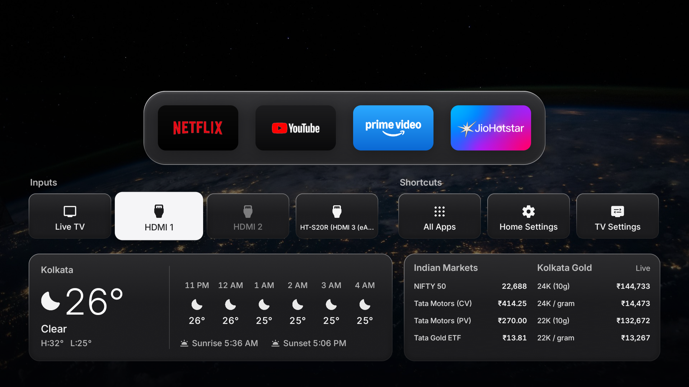
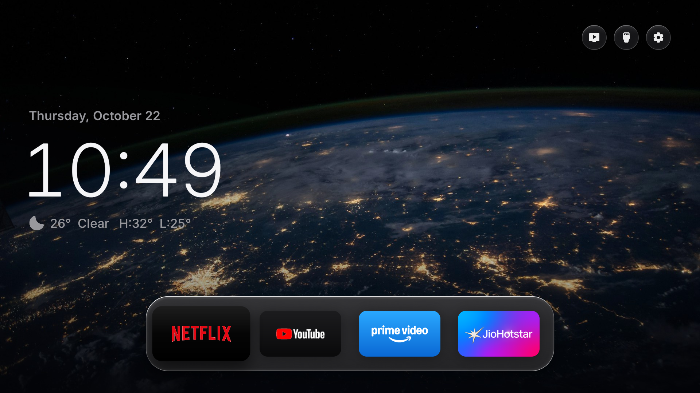

# Ad-Free TV Exp

A clean, minimalist, ad-free Apple TV experience for Android TV and Google TV, featuring live Indian financial markets and city-level gold rates.

---

## 📸 Screenshots

### 1. Widgets Drawer (Live Indian Markets, Gold & Weather)
*Press **Down ↓** on the remote to reveal the widgets drawer with real-time updates.*



| Widget Section | Items Tracked | Update Mode |
| :--- | :--- | :--- |
| **Indian Markets** | **NIFTY 50** Index, **Tata Motors (CV)**, **Tata Motors (PV)**, **Tata Gold ETF** | Live background fetch |
| **Kolkata Gold** | **24K Gold** (per gram & 10g), **22K Gold** (per gram & 10g) | Live spot + retail rates |
| **Local Weather** | Current conditions, hourly forecast, sunrise & sunset times | Local coordinates (Kolkata) |
| **Quick Actions** | Connected HDMI inputs, Live TV, All Apps drawer, TV & Home settings | Real-time status |

---

### 2. Pristine Apple TV Home Screen
*A distraction-free, zero-ad home screen with official Earth-from-orbit cinematic aerial wallpaper and frosted glass dock.*



---

## ✨ Features

- **Apple TV 4K Aesthetic:**
  - High-definition official Earth-from-orbit aerial wallpaper with cinematic atmospheric lighting.
  - Premium frosted glass app dock and floating cards.
  - Permanent dark mode by default for home theater viewing.
  - Uncluttered starting screen (only Date, Clock, and Weather above the dock).

- **Live Indian Markets & Kolkata Gold Widget:**
  - Sub-section inside the bottom drawer keeping the main screen clean.
  - Live **NIFTY 50** tracking.
  - Live **Tata Motors** tracking for both commercial and passenger entities (`TMCV.NS` & `TMPV.NS`).
  - Live **Tata Gold ETF** tracking (`TATAGOLD.NS`).
  - Live **Kolkata Gold rates** for both 24K and 22K purity (per gram and per 10 grams).
  - Background caching so data appears instantaneously upon waking the TV.

- **Completely Ad-Free & Reversible:**
  - Safely hides Google TV's promotional bloat, sponsor cards, and launcher advertisements.
  - Non-destructive: never uninstalls or disables system frameworks.
  - Instant rollback option in settings at any time.

---

## 🛠️ Building & Installing

### Prerequisites
- JDK 17+
- Android SDK build-tools (33+) and platform `android-34`
- `adb`

### Build APK
```bash
./build.sh
```

### Install onto TV via ADB
```bash
adb connect <TV-IP>:5555
adb install -r FreeMyTV.apk
```

---

## 📄 License
MIT License. See [LICENSE](LICENSE) for details.
