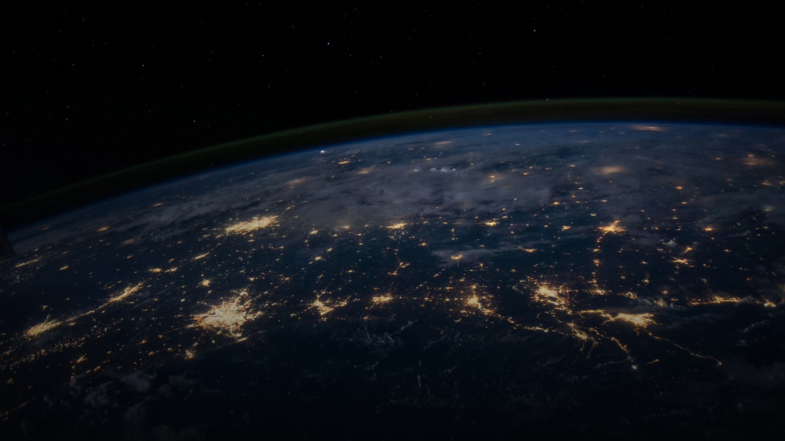

# Ad-Free TV Exp

A clean, minimalist, ad-free Apple TV experience for Android TV and Google TV.



## Features

- **Apple TV 4K Aesthetic:**
  - High-definition official Earth-from-orbit aerial wallpaper with cinematic atmospheric lighting.
  - Premium frosted glass dock and widgets.
  - Permanent dark mode by default.

- **Live Indian Markets & Kolkata Gold Rates:**
  - Dedicated **Widgets Drawer** (press **Down ↓** on remote):
    - **NIFTY 50** Index (Live)
    - **Tata Motors** (Both Commercial Vehicles & Passenger Vehicles)
    - **Tata Gold ETF**
    - **Kolkata Gold Rates:** Live 24K and 22K (per gram and per 10 grams)
  - Automatic background price caching & updates.

- **Completely Ad-Free & Reversible:**
  - Safely swaps out intrusive Google TV launcher ads and promotional bloat.
  - Non-destructive: never uninstalls system apps.
  - Instant rollback option in settings.

## Building and Installing

### Prerequisites
- JDK 17+
- Android SDK build-tools (33+) and platform `android-34`
- `adb`

### Build
```bash
./build.sh
```

### Install via ADB
```bash
adb connect <TV-IP>:5555
adb install -r FreeMyTV.apk
```

## License
MIT License. See [LICENSE](LICENSE) for details.
